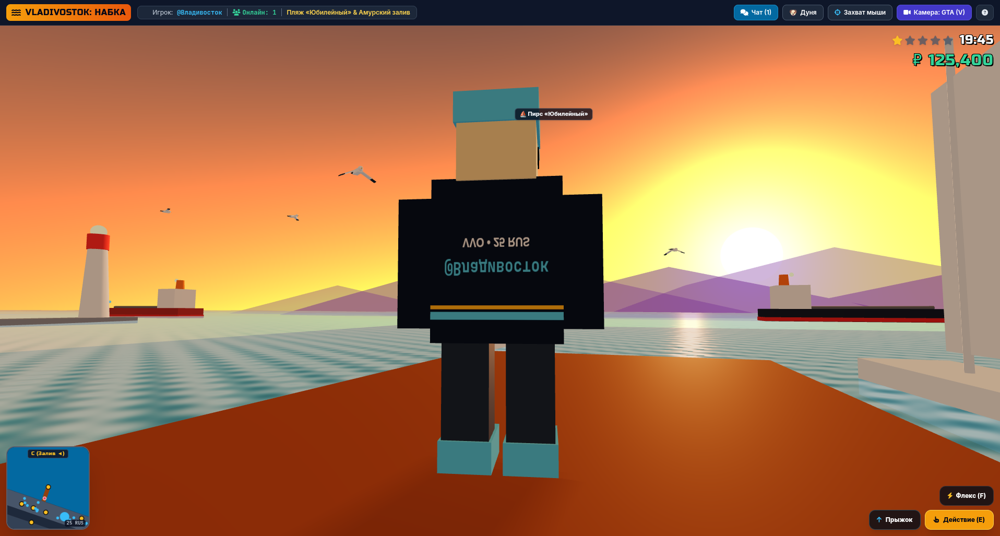

# Набка (Nabka) — Vladivostok Waterfront Multiplayer

A 3D open-world multiplayer browser game set on the iconic **Sportivnaya Embankment (Спортивная набережная / «Набка»)** in Vladivostok, Russia.

Explore the waterfront promenade overlooking Amur Bay in third-person view, swim and dive underwater among local marine life, drive right-hand-drive Japanese cars with realistic drift physics, pet companion animals, fire the historic Vladivostok noon cannon, chat with local personas using authentic Vladivostok slang, and hang out with other players in real time.



---

## Features

- 🌊 **Sportivnaya Embankment Landmark World**: Amur Bay horizon, sopki hills, central fountain, Ocean cinema, Olympiets complex, Dynamo stadium with night floodlights and accessible gates, Vladivostok Fortress battery with historic cannons, Jubilee beach, piers, street lamps, and hot pyanse kiosks.
- 🤿 **Swimmable Sea & Amur Bay Underwater Ecosystem**:
  - Seamless water entry from shore or pier into a natural sloped seabed (0m depth at shore, dropping to 6m at pier end, down to 10m depth).
  - Automated depth maintenance (~1.5m above seafloor) with smooth prone breaststroke swimming.
  - Transparent ocean with animated normal map water ripples and dynamic day/night cubemap sky reflection.
  - Clear underwater teal atmosphere (~20m visibility) and submerged third-person camera mode.
  - Local Far Eastern marine fauna & flora: Flounder (*камбала*), greenling (*терпуг*), rockfish (*окунь*), jellyfish (*медузы*), Amur starfish (*амурская звезда*), Patiria pectinifera (*гребешковая патирия*), and kelp bushes (*ламинария* / морская капуста).
  - Underwater audio engine featuring authentic `dive.mp3` ambient sound loop, surface ambience crossfading and ducking, and gull/horn muting while submerged.

- 🏎️ **Right-Hand-Drive JDM Cars & Drift Physics**:
  - Drivable classics: Toyota Mark II Tourer V, Mazda Roadster, Subaru Forester STI, Suzuki Jimny, Subaru Impreza WRX.
  - Realistic physics engine with 160 km/h top speed, punchy straight-line acceleration, tire scrub deceleration, and traction recovery surges when straightening out.
  - Multi-camera modes (`V`): Third-person GTA camera, close action, wide panorama, and first-person right-hand-drive cockpit view.
- 🐾 **Pet Companions**: Explore alongside Maltese dog **Дуня (Dunya)** or cat **Берик (Berik)**. Pets follow the player along the promenade, wait safely on the shore while the player swims, ride in the passenger seat while driving, and perform tricks (`F`) or lie down when resting.
- 💥 **Vladivostok Fortress Midday Cannon Shot (Полуденный выстрел)**:
  - Real-time midday cannon blast at 12:00 Vladivostok time (VLAT, UTC+10) from the coastal battery.
  - Branching quest line with Captain Mikhalych to earn the honorary privilege to fire the cannon (50,000 ₽ fee) with synchronized multiplayer explosion, smoke, and audio.
- 🗣️ **Local Slang & Branching NPC Dialogue**: Interact with Vladivostok characters (*Дэн с Зелёнки*, *Тётя Роза*, *Капитан Михалыч*, *Синоптик Игорь*, *Алиса с Фокина*, *Яхтсмен Макс*, etc.) with authentic multi-stage dialogues, local lore, and quest lines.
- 🌅 **Dynamic Day/Night & Weather**: Real-time Vladivostok time clock (VLAT, UTC+10) with automatic dawn, day, sunset over Amur Bay, dusk, and night lighting transitions, activating street lights and stadium spotlights.
- 🌐 **Stateful Multiplayer**: Low-latency WebSocket synchronization via binary MessagePack (`msgpack`), client-side dead-reckoning and interpolation, live chat, and server-authoritative world entities (players, vehicles, quest events).

---

## Tech Stack

- **Backend**: Go 1.24 with `fasthttp`, `fasthttp/websocket`, and `vmihailenco/msgpack/v5`. Stateful in-memory actor model with bounded queues, slow-consumer eviction, and graceful shutdown.
- **Frontend**: Zero-build ES modules in standard modern JavaScript, Three.js r128, HTML5 Canvas procedural texturing, Tailwind CSS, Font Awesome, and binary glTF 2.0 (`.glb`) 3D assets.
- **Audio**: Web Audio API engine with spatial sound, ambient bay surf, seagull calls, engine gear loops, drift audio, and underwater dive ambience.
- **Packaging**: Multi-stage Docker build producing a minimal `FROM scratch` container using vendored dependencies (`-mod=vendor`).

---

## Quickstart

### Prerequisites
- [Go 1.24+](https://go.dev/dl/)
- [Bun](https://bun.sh/) (for running frontend tests and the standalone model editor)

### Running Locally
```sh
# Start the Go game server
go run -mod=vendor ./cmd/server
```
Open [http://localhost:8080/](http://localhost:8080/) in your browser.

To customize the port:
```sh
PORT=9090 go run -mod=vendor ./cmd/server
```

### Running with Docker
```sh
# Build minimal scratch container image
docker build -t nabka:latest .

# Run container
docker run -d -p 8080:8080 --name nabka nabka:latest
```

---

## Controls

### Keyboard & Mouse
| Action | Key / Input |
|---|---|
| **Move / Steer / Swim** | `W`, `A`, `S`, `D` / Arrow Keys |
| **Sprint / Fast Swim** | `Shift` (unlimited stamina) |
| **Jump** | `Space` (when on land) |
| **Vehicle Handbrake** | `Space` |
| **Vehicle Nitro / Boost** | `Shift` (up to 200 km/h) |
| **Interact / Enter Vehicle** | `E` |
| **Camera Mode** | `V` (Normal, Action, Panorama, Cockpit) |
| **Pet Trick / Emote** | `F` |
| **Toggle Vehicle Lights** | `L` |
| **Mouse Look** | Right-click drag or click canvas for Pointer Lock (`ESC` to release) |
| **Chat** | `Enter` to open/send, `ESC` to close |

### Touch & Mobile
- Virtual joystick on bottom-left for walking, swimming, and steering.
- On-screen touch buttons for jumping, accelerating, reversing, handbraking, interactions, and camera toggle.

---

## Testing & Verification

Run all test suites from repository root:

```sh
# Frontend unit tests (201 tests across 12 test suites)
bun test

# Backend integration and protocol tests with Go race detector
go test -mod=vendor -race ./...

# Static analysis
go vet -mod=vendor ./...
```

---

## Standalone 3D Map & Model Editor

Nabka includes a visual 3D editor for landmarks, vehicles, props, and world colliders:

```sh
# Start editor server on localhost:8090
bun editor/server.js

# Export all Blockbench models to binary .glb
EDITOR_PORT=0 bun editor/server.js --export-models
```
Open [http://localhost:8090/editor/index.html](http://localhost:8090/editor/index.html). *(The editor is standalone and excluded from production Docker builds.)*

---

## License

This project is licensed under the [MIT License](LICENSE).
